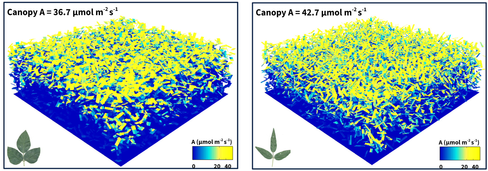

# Code for: Leaflet shape modulates canopy light-use efficiency by partitioning light more evenly among soybean leaves

Bishal G. Tamang

Canopy net photosynthesis (canopy A) simulated with Helios for a broad-leaflet (left) and a
narrow-leaflet (right) soybean canopy.

This repository holds the analysis code of the article. The study compared broad- and
narrow-leaflet soybean near-isogenic lines grown in 2024 at two University of Illinois field sites,
SoyFACE and the Energy Farm, in 38-cm and 76-cm rows. Canopy photosynthesis of 530 plots was
simulated with the three-dimensional model Helios on each date leaf area index (LAI) was measured
(5,299 plot-dates) and compared with a one-dimensional sun-shade model. The simulations were checked
against in-canopy light profiles (LITES and SunScan) at SoyFACE and airborne LiDAR at the Energy
Farm. Helios canopy traits were then used in a genome-wide association analysis of 188 lines.

## Data and archived version

The repository contains code only. The measured data, the simulation inputs and outputs, and the
archived copy of this code are in the dataset at the Illinois Data Bank:

https://doi.org/10.13012/B2IDB-9478251_V1

The dataset is the version of record for the article. This repository is a convenient place to
read the scripts and holds any later corrections.

## How to run

1. Download the dataset from the Illinois Data Bank and unzip the main archive into an empty folder.
   The four per-leaf archives (25 GB unzipped) are needed only for Figs 2D, 3C-D and S7C-D (sections
   `fig2d` and `fig3cd` of the figure script; `fig2d` needs about 20 GB of memory) and for the
   LITES-Helios comparison; unzip them into the same folder if those are wanted.
2. The dataset already contains this code in its `code/` folder. To use the version in this
   repository, copy the folders inside `code/` from here over the ones in the dataset.
3. Run each script from the main folder of the dataset, for example

       Rscript code/5_genetics/01_per_plot_traits.R
       python code/1_leaf_inputs/leaf_optics/01_parse_july_spectra.py

Each script starts with a description of what it does, its inputs and outputs, and how to run it.
Scripts read from `data/` and `outputs/` and write their results to `outputs/`. Within each folder,
run the scripts in numeric order.

## Folders

1. `code/1_leaf_inputs/` - leaf optics from the leaf spectra with PROSPECT-D (`leaf_optics/`), and
   dark respiration (Rd25) from the A-Ci curves fitted with PhotoGEA (`aci_respiration/`). Run
   `leaf_optics/` first.
2. `code/2_helios_simulation/` - the Helios program and the scripts used to build and run it on a
   computing cluster, and to combine the per-run outputs.
3. `code/3_mesh_test/` - the test of 1 to 225 sub-leaf elements per leaflet.
4. `code/4_one_dimensional_model/` - the one-dimensional sun-shade model and its sensitivity check.
5. `code/5_genetics/` - line BLUPs, heritability, kinship and association scans.
6. `code/6_field_validation/` - LiDAR (`lidar/`) and LITES and SunScan (`lites_sunscan/`) analyses.
7. `code/7_figures/all_figures.R` - all figures of the article, main and supplementary, in one
   script. It draws the panels and writes the statistics and tables behind the numbers in the
   article to `outputs/figures/`. Each figure or group of panels is one section of the script:

       Rscript code/7_figures/all_figures.R                  all sections
       Rscript code/7_figures/all_figures.R fig4a figS4      only the named sections
       Rscript code/7_figures/all_figures.R --list           print the section names

   The dataset holds the same code as one script per figure or group of panels. The field maps in
   Fig 1A-B, the photograph in Fig 1D and the Helios canopy images in Figs 2B and 3E are not
   produced by code.

`docs/helios_build.md` explains how to build the two Helios programs, and `docs/cluster_run.md` how
they were run on the cluster.

Notes:

- The Helios simulations need Helios release 1.3.71 (commit c710cdfb), CUDA and an NVIDIA GPU, and
  were run on a computing cluster. Helios itself is not included; see `docs/helios_build.md`.
- The A-Ci curve fits use a random optimizer and were run without a fixed seed, so a new fit gives
  slightly different values. A new fit is saved as `aci_fits_per_plant_refit.csv`. The fits used in
  the article are in the dataset (`outputs/leaf_inputs/aci_fits_per_plant.csv`) and are read by the
  later steps.
- The first two LiDAR scripts read the point clouds of the 224 Energy Farm plots simulated with
  Helios, which are a separate archive of the dataset (`lidar_point_clouds_ef.zip`, unzipped into
  the same folder).
- The Excel recalculation of the LI-6800 files (`aci_respiration/00`) needs Excel and the original
  instrument files. The recalculated workbooks are in the dataset.

## Software

The analyses used R 4.5.2. All scripts were rerun from the dataset with R 4.6.1 and Python 3.12.10
and gave the same results, apart from differences in the last digits of some values, two very small
P values that R 4.6.1 prints as zero (both reported as P < 1e-10), and the random point positions in
Figs 2A and 6B. Package versions used in the rerun:

- R packages: data.table 1.18.6.1, dplyr 1.2.1, ggdist 3.3.3, ggnewscale 0.5.2, ggplot2 4.0.3,
  lme4 2.0.6, lubridate 1.9.5, openxlsx 4.2.8.1, patchwork 1.3.2, PhotoGEA 1.4.0, ragg 1.5.2,
  readr 2.2.0, readxl 1.5.0, rrBLUP 4.6.3, scales 1.4.0, tidyr 1.3.2
- Python packages: pandas 3.0.3, numpy 2.5.1, scipy 1.18.1, specdal 0.2.1, prosail 2.0.5
- Helios release 1.3.71 (https://github.com/PlantSimulationLab/Helios), CUDA 12.8

## Citation

If you use this code, please cite the article and the dataset:

Tamang BG, Digrado A, Bernacchi CJ, Ainsworth EA. Leaflet shape modulates canopy light-use
efficiency by partitioning light more evenly among soybean leaves.

Tamang BG, Digrado A, Bernacchi CJ, Ainsworth EA. Data for: Leaflet shape modulates canopy light-use
efficiency by partitioning light more evenly among soybean leaves. University of Illinois
Urbana-Champaign. https://doi.org/10.13012/B2IDB-9478251_V1

## Funding

Realizing Increased Photosynthetic Efficiency (RIPE), Gates Agricultural Innovations grant
investment 57248.

## License

The code is released under the GNU General Public License version 3 (see `LICENSE`), matching the
Helios framework that the simulation programs build on. The two guides in `docs/` are shared under
CC BY 4.0 (https://creativecommons.org/licenses/by/4.0/).

## Questions

Open an issue in this repository, or write to the corresponding author named in the article.
